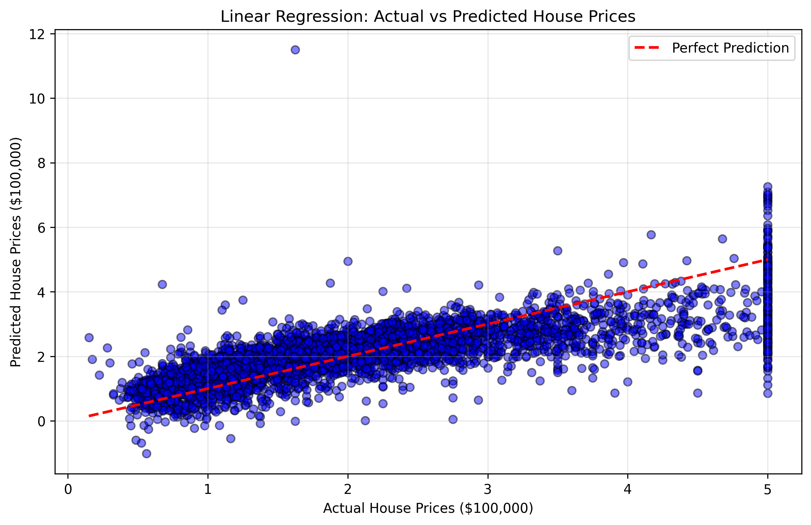

<div align="center">

# California Housing Linear Regression

**A simple, end-to-end linear regression project for predicting California house values.**

[](https://www.python.org/)
[](https://scikit-learn.org/)

</div>

---

## About the Project

This project uses scikit-learn's **California Housing Dataset** to train a linear regression model that predicts median house values from features such as:

- Median income
- Average house age
- Average number of rooms
- Average number of bedrooms
- Population
- Average household size
- Latitude
- Longitude

The script splits the dataset into training and testing sets, fits a `LinearRegression` model, prints sample predictions and model information, and creates a comparison plot.

## Demo

<div align="center">



*Actual house values are compared with model predictions. The red dashed line represents perfect predictions.*

</div>

## Project Structure

```text
Linear_Regression-/
├── main.py                  # Model training and visualization script
├── housing_predictions.png  # Generated actual vs. predicted plot
└── README.md                # Project documentation
```

## Tech Stack

| Tool | Purpose |
| --- | --- |
| Python | Core programming language |
| pandas | Data loading and manipulation |
| scikit-learn | Dataset, train/test split, and linear regression model |
| Matplotlib | Visualization |

## Getting Started

### Prerequisites

- Python 3.9 or newer
- `pip`

### Installation

Clone the repository:

```bash
git clone https://github.com/Prktriesitout/Linear_Regression-.git
cd Linear_Regression-
```

Create and activate a virtual environment:

```bash
python -m venv .venv
source .venv/bin/activate
```

On Windows, use:

```powershell
.venv\Scripts\activate
```

Install the required packages:

```bash
pip install pandas scikit-learn matplotlib
```

## Usage

Run the project from the repository root:

```bash
python main.py
```

The script will:

1. Load the California Housing Dataset.
2. Split the data into 80% training and 20% testing sets.
3. Initialize and train a linear regression model.
4. Print the intercept, dataset shapes, and five sample predictions.
5. Save the visualization as `housing_predictions.png`.

## Output

Example console output:

```text
--- Model Initialized ---
LinearRegression()

--- Model Trained ---
Intercept: ...

--- Data Split ---
X_train shape: (16512, 8)
X_test shape: (4128, 8)
y_train shape: (16512,)
y_test shape: (4128,)

--- Predictions ---
[...]
```

The plot is generated at:

```text
housing_predictions.png
```

## Dataset Information

This project uses `fetch_california_housing()` from scikit-learn. The target value represents the median house value in each block group.

> Target values are expressed in units of $100,000. For example, a prediction of `2.5` represents approximately $250,000.

## Future Improvements

- Add evaluation metrics such as R² and RMSE
- Support command-line configuration
- Compare linear regression with regularized models
- Add feature scaling
- Add unit tests

## Contributing

Contributions, issues, and feature requests are welcome.

1. Fork the project.
2. Create a feature branch:

   ```bash
   git checkout -b feature/new-feature
   ```

3. Commit your changes:

   ```bash
   git commit -m "Add new feature"
   ```

4. Push your branch and open a pull request.

## Author

Created by [Prktriesitout](https://github.com/Prktriesitout).
